<p align="center">
  
</p>

<p align="center">
  <a href="https://www.linkedin.com/in/hayatharoon/"></a>
  <a href="mailto:haroonhayat735@gmail.com"></a>
  
</p>

<p align="center">
  <b>5+ years shipping production B2B SaaS. These days: AI agents that actually ship.</b><br/>
  Remote with teams in the 🇬🇧 UK, 🇺🇸 US, 🇫🇷 France and the GCC, including 2.5 years for clients in Riyadh and Dubai.
</p>

<table align="center">
  <tr>
    <td align="center"><h2>520M+</h2><sub>records behind the AI search I built</sub></td>
    <td align="center"><h2>5M+</h2><sub>personalised pages generated</sub></td>
    <td align="center"><h2>1,800+</h2><sub>companies on platforms I built for</sub></td>
    <td align="center"><h2>20K</h2><sub>concurrent exam sessions</sub></td>
  </tr>
</table>

## ⚡ What I've built

<table>
  <tr>
    <td width="50%" valign="top">
      <h3>🤖 SendrAI</h3>
      <sub>Sendr · UK</sub><br/>
      Two-tier agentic LLM system: a meta-agent turns plain English into tasks, row-level agents search and call tools. Strict output validation, <b>3–4x faster</b>.
    </td>
    <td width="50%" valign="top">
      <h3>🎬 LipSync</h3>
      <sub>Sendr · UK</sub><br/>
      Generative video and voice cloning: one recording becomes thousands of personalised videos. Rebuilt for <b>12x faster</b> output.
    </td>
  </tr>
  <tr>
    <td valign="top">
      <h3>🧭 sendr-triage-bot</h3>
      <sub>Claude Agent SDK · MCP</sub><br/>
      Production multi-agent system with MCP tool servers that triages, deduplicates and routes engineering issues.
    </td>
    <td valign="top">
      <h3>🇸🇦 AstroLabs &amp; Najm</h3>
      <sub>Riyadh · Dubai</sub><br/>
      Full-stack features for setupinsaudi.com and astrolabs.com, used by <b>1,800+ companies</b>. Contributed to Najm, their AI licensing consultant.
    </td>
  </tr>
  <tr>
    <td valign="top">
      <h3>🏛️ FirmSanad</h3>
      <sub>Riyadh</sub><br/>
      Incorporation platform frontend: AI-guided intake, MISA, CR, ZATCA and GOSI registration flows.
    </td>
    <td valign="top">
      <h3>🎓 Mereos</h3>
      <sub>Paris · EdTech</sub><br/>
      Exam portals and a proctoring Chrome extension for <b>100+ institutions</b>, including ESCP and emlyon.
    </td>
  </tr>
</table>

## 🛣️ Journey

```text
2024 ─ now   Sendr (UK, remote) ........... Full Stack & AI Engineer
2024 ─ 2025  Productbox ................... Full Stack Engineer
2023 ─ 2024  JMM Technologies ............. Frontend Engineer
2023         Gitlogix ..................... Frontend Engineer
2021 ─ 2022  AtriaLogic & IT Hub .......... Frontend Engineer
2017 ─ 2021  University of Malakand ....... BS Computer Science · 🥈 Silver Medal
```

<p align="center"><sub>Got something hard to build? <a href="https://www.linkedin.com/in/hayatharoon/">Let's talk.</a></sub></p>
