<!-- readme-atelier:start -->
<!-- Generated by Readme Atelier (https://github.com/monokernn/readme-atelier). Edit atelier.yml instead of this block. -->

<picture><source media="(prefers-color-scheme: dark)" srcset="./atelier/header-dark.d9986e8c.svg"/></picture>

  <a href="https://x.com/hanohayat"><picture><source media="(prefers-color-scheme: dark)" srcset="./atelier/social-x-dark.09f54aa6.svg"/></picture></a>&nbsp;
  <a href="https://github.com/hayatharoon"><picture><source media="(prefers-color-scheme: dark)" srcset="./atelier/social-github-dark.e20bc474.svg"/></picture></a>&nbsp;
  <a href="https://haroonhayat.hashnode.dev"><picture><source media="(prefers-color-scheme: dark)" srcset="./atelier/social-website-dark.380a1fbc.svg"/></picture></a>&nbsp;
  <a href="https://www.linkedin.com/in/hayatharoon"><picture><source media="(prefers-color-scheme: dark)" srcset="./atelier/social-linkedin-dark.76b4d82f.svg"/></picture></a>

  <picture><source media="(prefers-color-scheme: dark)" srcset="./atelier/stats-dark.e1998e0a.svg"/></picture>
  <picture><source media="(prefers-color-scheme: dark)" srcset="./atelier/languages-dark.1d6f71a1.svg"/></picture>

<picture><source media="(prefers-color-scheme: dark)" srcset="./atelier/activity-dark.05068361.svg"/></picture>

  <a href="https://github.com/hayatharoon/BugBook"><picture><source media="(prefers-color-scheme: dark)" srcset="./atelier/repo-1-dark.9c112774.svg"/></picture></a>
  <a href="https://github.com/hayatharoon/react-design-patterns"><picture><source media="(prefers-color-scheme: dark)" srcset="./atelier/repo-2-dark.258e5e66.svg"/></picture></a>
  <a href="https://github.com/hayatharoon/discord-clone"><picture><source media="(prefers-color-scheme: dark)" srcset="./atelier/repo-3-dark.0975ce72.svg"/></picture></a>
  <a href="https://github.com/hayatharoon/haroon-portfolio"><picture><source media="(prefers-color-scheme: dark)" srcset="./atelier/repo-4-dark.f8fe9a92.svg"/></picture></a>

<picture><source media="(prefers-color-scheme: dark)" srcset="./atelier/stack-dark.0f29da55.svg"/></picture>

<picture><source media="(prefers-color-scheme: dark)" srcset="./atelier/footer-dark.a9bc51cc.svg"/></picture>

<!-- readme-atelier:end -->
